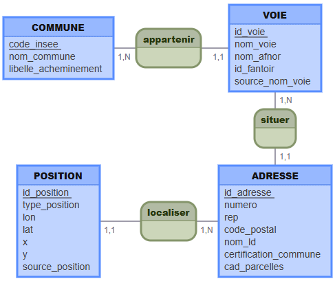
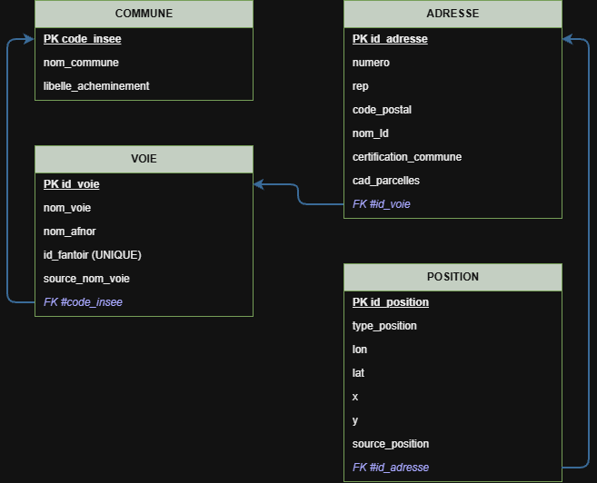
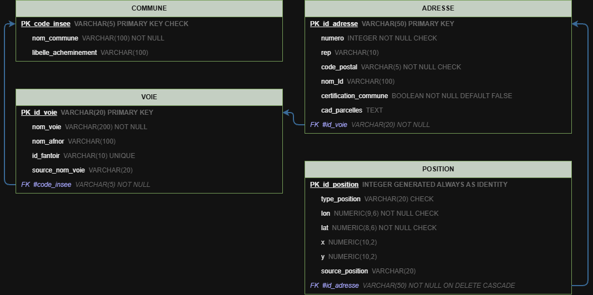

Pas pu le finir compte tenu du temps qu'on avait :'(

- RG1 : une commune n'a qu'un seul code INSEE
- RG2 : une voie n'a qu'une seule commune, une commune peut avoir plusieurs voies
- RG3 : une adresse n'a qu'une seule voie, une voie peut avoir plusieurs adresses
- RG4 : une adresse n'a qu'un seul code postal
- RG5 : dans une voie, un même numéro avec le même rep n'existe qu'une seule fois
- RG6 : une adresse peut avoir plusieurs positions, une position n'a qu'une seule adresse
- RG7 : une adresse peut avoir plusieurs parcelles

# MCD

# MLD

# MPD

